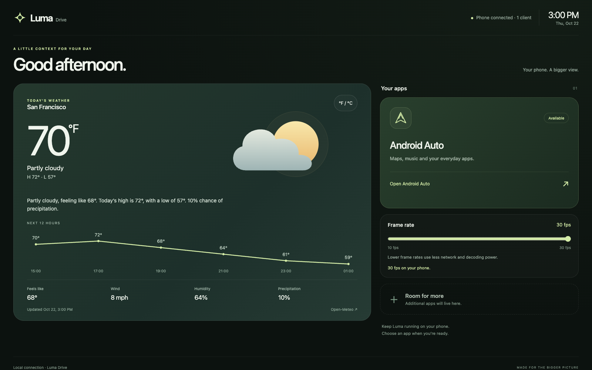
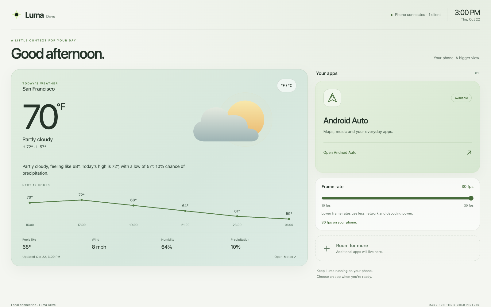
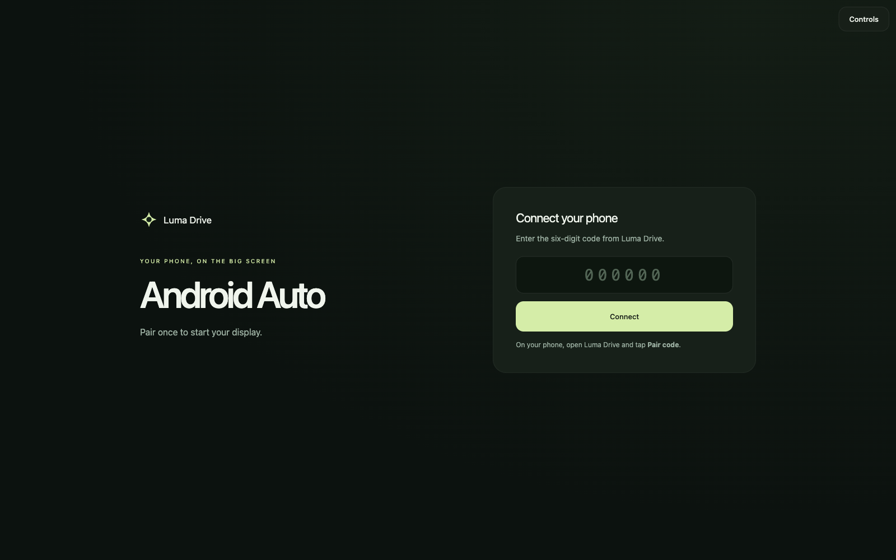
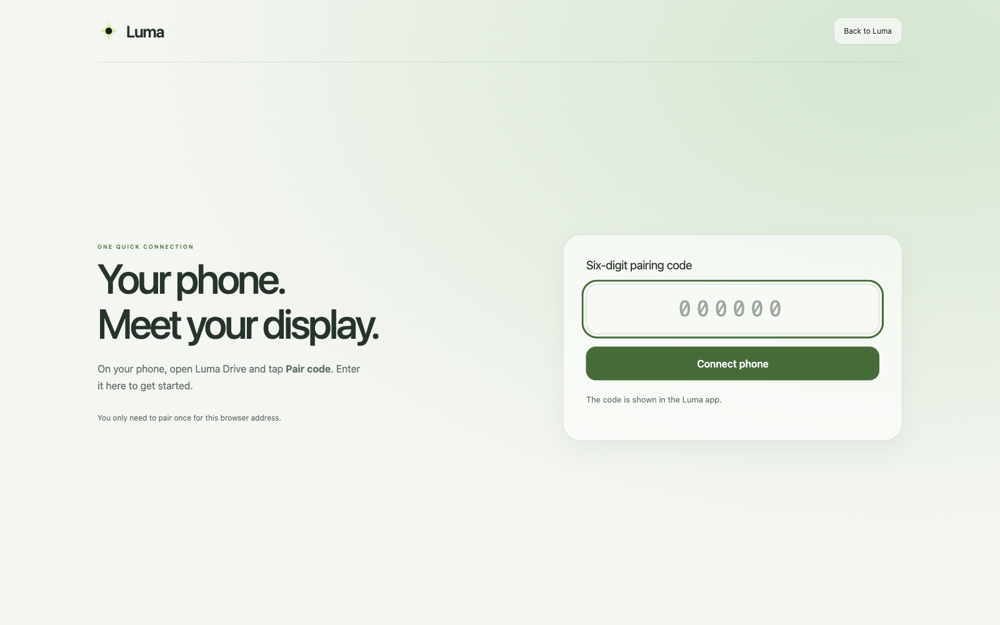

# Luma Drive

Luma Drive is an Android Auto receiver that displays the projected interface in
a browser on the phone's local network. It does not mirror the phone screen. It
is an independent project and is not affiliated with or certified by Google,
Android Auto, or Tesla.

**Public source and APKs do not include an accepted Android Auto receiver
identity. A fresh installation needs separate, authorized identity
provisioning before it can authenticate.** The personal bench device uses a
legacy AASDK receiver identity provisioned outside this repository and held in
Android Keystore. That identity is for personal testing only; it is not a
production credential or authorization to distribute an operational receiver.
An APK signing key is separate from this receiver identity. See
[authentication and provisioning](docs/AUTHENTICATION.md).

## Architecture

```text
PHONE
  Android Auto head-unit server
    (local TLS, port 5277)
           |
           v
  Luma receiver (AASDK protocol / TLS)
           +-- H.264 video --> hardware decode --> WebRTC video encode -------+
           |                                                                   |
           +-- PCM16, 48 kHz stereo --> unchanged framed audio data channel ---+
                                                                               |
  Local HTTP server, port 9092: pairing + SDP signaling only                  |
  Optional local VPN route alias 100.99.9.9; mDNS luma.local                   |
                                                                               v
  PHONE HOTSPOT / LOCAL WI-FI ---------------------------------> PAIRED BROWSER
                                                                WebRTC receiver
                                                                remote AA interface
                                                                touch/control ---> phone
```

The browser displays Android Auto's projected interface. Luma does not mirror
the phone screen. Pairing and SDP signaling use local HTTP; WebRTC carries
video, audio, and controls directly over the local network. The optional route
alias and `luma.local` name provide local reachability; browser media does not
run through a cloud service or a VPN media tunnel.

## Screenshots

The launcher screenshots show real Luma UI with generic weather demonstration
data; they contain no personal map or account content. The AA browser connection
screen is a bench capture, not Tesla validation evidence.

| Launcher · dark | Launcher · light |
| --- | --- |
|  |  |

| Android Auto connection screen · bench capture | Browser pairing · bench capture |
| --- | --- |
|  |  |

## Supported features

- Receives Android Auto from the phone's head-unit server and displays it in a
  paired browser on the local network. Android Auto is the only projection
  provider implemented.
- Supports 720p by default or selectable 1080p, and a shared 10–30 FPS ceiling
  for paired browsers (30 FPS default); actual playback may be lower.
- Hardware-decodes H.264 on the phone and WebRTC-encodes video for browser
  playback. This is a remote Android Auto interface, not screen mirroring.
- Carries PCM16, 48 kHz stereo in unchanged frames over a WebRTC data channel;
  sends touch and controls back over a separate channel. Bit-perfect speaker
  output is not established.
- Keeps the phone-side decoder warm while Android Auto remains active, including
  when no browser is connected. Browser pages can reconnect during a 30-second
  presence grace period.
- Provides local pairing, connection diagnostics, an optional connection test,
  and a launcher with optional phone weather. Standalone providers such as
  Netflix are not implemented; compatible music apps run through Android Auto.

## Requirements

- Android 9 (API 28) or newer.
- Android Auto with its developer head-unit server enabled. Start that server
  manually after a phone reboot.
- A phone hotspot or another private local network shared with the browser
  device. Local-name discovery depends on mDNS support; a numeric address is
  available as a fallback.
- For source builds: JDK 17, Android SDK platform 35 and build-tools 34.0.0,
  Node.js 18 or newer, and Python 3. Gradle dependencies may need network access
  on the first build.

## Setup and use

1. Enable Android Auto developer mode and start its head-unit server from the
   Android Auto settings menu. This is separate from Android USB/wireless
   debugging. Repeat after a reboot.
2. Open Luma Drive on the phone, tap **Start drive**, and grant Android's VPN
   permission. Enable the hotspot and connect the browser device.
3. Open `http://luma.local:9092/` or the address shown in Luma. Use the numeric
   fallback with port 9092 if name resolution fails.
4. Choose **Android Auto** in the launcher. If asked, tap **Pair code** in Luma
   on the phone and enter the short-lived code in the browser. Pairing is tied
   to the browser origin; a different hostname may need a new pairing.
5. The display starts automatically. If browser policy blocks playback or
   fullscreen, open **Controls** and use **Enable audio** or **Full screen**.

See [quick start](docs/QUICK_START.md) for hotspot, VPN, and recovery details.

The app uses local HTTP for pairing and WebRTC signaling. Media and data
channels use WebRTC's encrypted transport, with no cloud signaling, STUN, or
TURN service. Use a private network and do not expose the service to the
Internet. Luma does not record microphone audio; it declines microphone capture
requests. Android Auto's projected content can include private account,
location, and media information.

## Build

```sh
./gradlew testDebugUnitTest assembleDebug
node --test tests/*.test.cjs
python3 tests/audio_route_test.py
python3 tools/audit_public.py
```

GitHub Actions runs these checks on pushes and pull requests to `main`; see the
[CI workflow](.github/workflows/ci.yml).

For a signed, shrunk release, set `PROJECTION_SIGNING_STORE` to an external
PKCS12 store with alias `projection` and set `PROJECTION_SIGNING_PASSWORD`, then
run:

```sh
./gradlew testDebugUnitTest assembleRelease
```

Keep signing material outside the repository. Without these variables, the
release APK is unsigned. APK signing does not provision Android Auto receiver
authentication. See [publishing](docs/PUBLISHING.md) and
[third-party notices](THIRD_PARTY_NOTICES.md).

## Validation and limits

The 0.4.5 receiver has been bench-tested for startup, recovery, and locked-screen
operation. Tesla browser, hotspot, speaker, and in-motion behavior have not been
validated. Long-drive battery and thermal behavior also remain unmeasured. The
phone decodes and re-encodes video, which adds processing, heat, battery use,
and latency. Android Auto chooses supported apps and layouts; arbitrary phone
apps, forced pane layouts, microphone/voice input, and Bluetooth-triggered
startup are not provided. Automatic hotspot control is optional and depends on
Android and carrier policy.

For media details see [audio evidence](docs/AUDIO.md), and for data handling see
[privacy](docs/PRIVACY.md). This project is licensed under GPL-3.0-or-later,
except for separately licensed components; see [LICENSE](LICENSE) and
[THIRD_PARTY_NOTICES.md](THIRD_PARTY_NOTICES.md).
